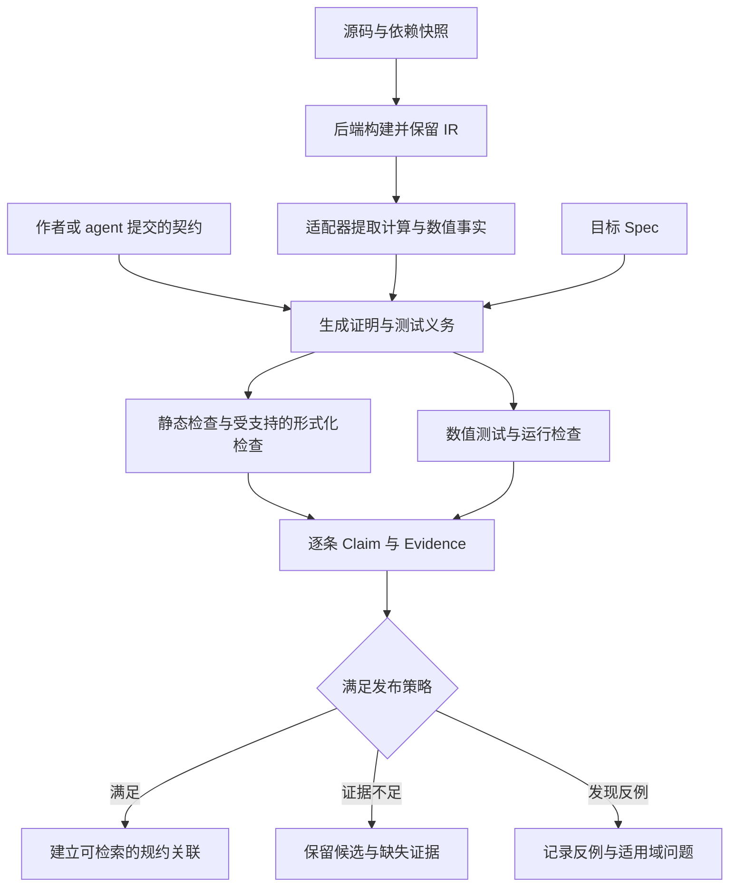
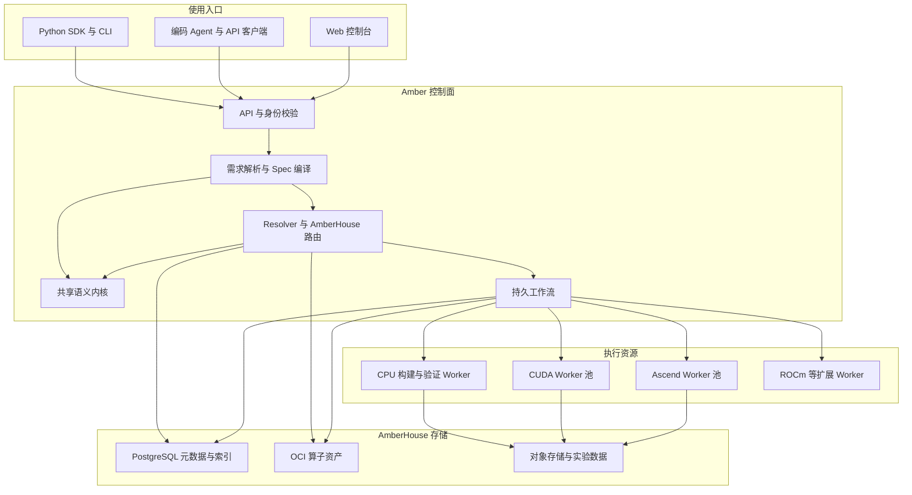
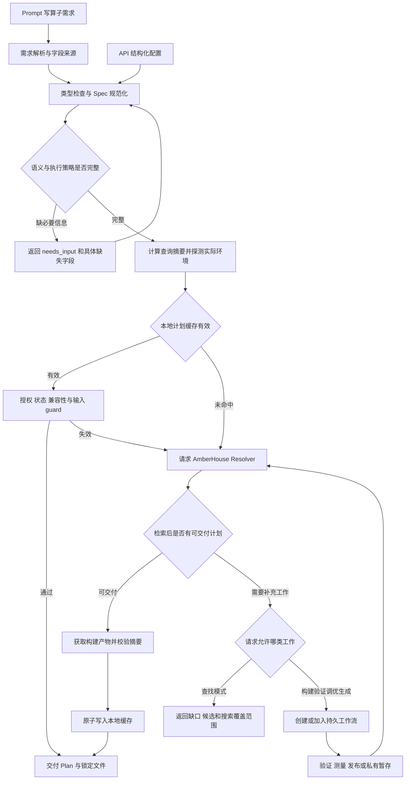
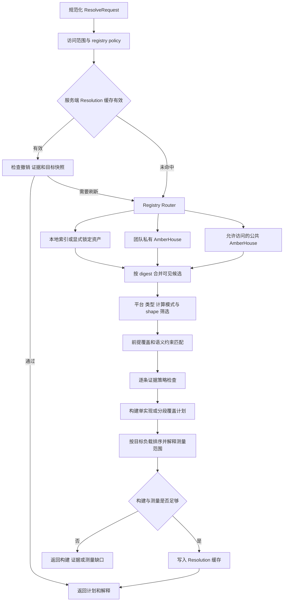
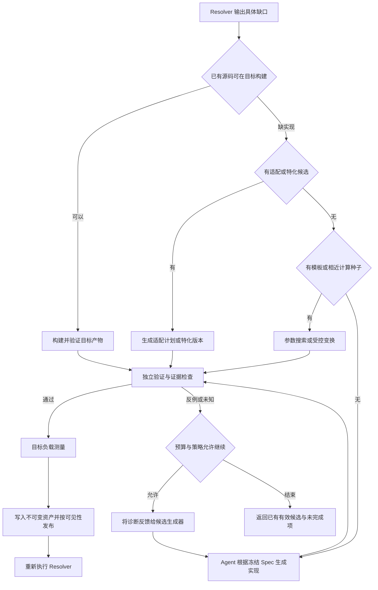
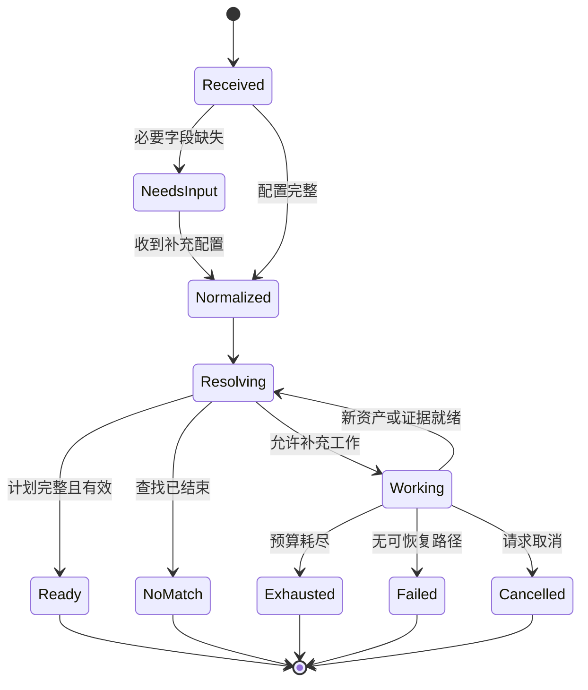
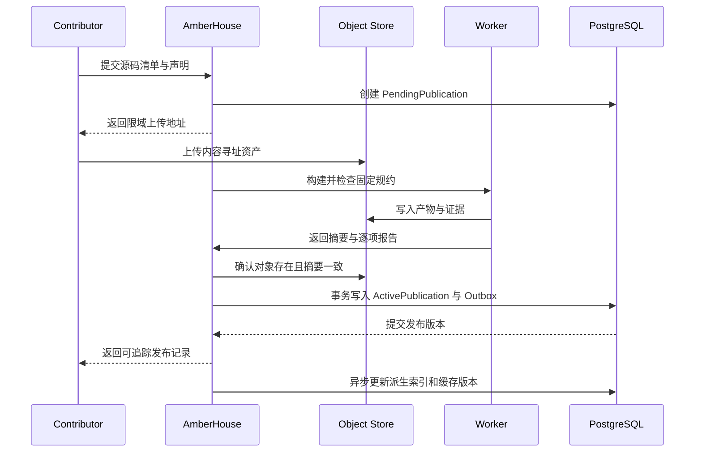
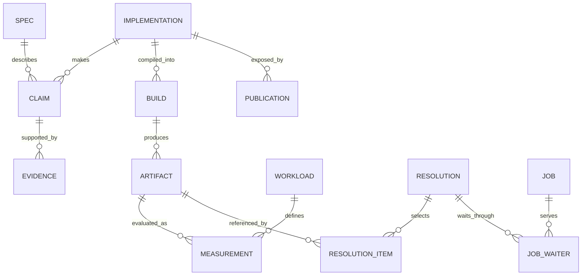
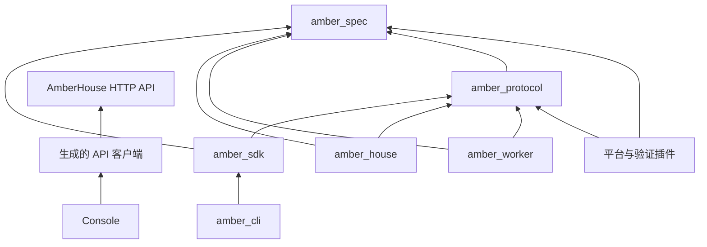

# Amber 项目设计

**基于可检查规约的高性能算子发现、复用与生成平台**

| 项目 | 内容 |
| --- | --- |
| 文档状态 | 架构设计提案，供独立 GitHub 仓库立项和后续实现使用 |
| 文档版本 | 0.1 |
| 更新日期 | 2026-11-18，Asia/Shanghai |
| 项目名称 | Amber |
| 算子仓名称 | AmberHouse |
| 首批硬件方向 | NVIDIA CUDA、华为 Ascend，后续扩展 AMD ROCm |
| 部署形态 | 公共算子仓与可自建私有实例，共用协议和代码 |
| 当前交付 | 产品定义、语言设计、技术栈、系统与代码架构、接口及实施规划 |

本文中的接口、包名、命令和配置均为拟议设计。正式实现以版本化 schema、语义测试和发布的 API 为准。文档中的示例预算与误差阈值仅用于说明配置形式。

## 目录

- [项目定位与命名](#project)
- [核心对象与系统约束](#model)
- [Amber Spec 语言设计](#spec)
- [规约匹配与可信提取](#matching)
- [系统架构与技术栈](#architecture)
- [请求到交付的完整流程](#request-flow)
- [AmberHouse 内部检索与路由](#routing)
- [缓存与身份标识](#caching)
- [未命中后的构建、调优与生成](#generation)
- [验证证据与发布](#verification)
- [性能评估与融合场景](#performance)
- [数据模型与一致性](#storage)
- [API、SDK 与 CLI](#api)
- [多后端与插件协议](#plugins)
- [GitHub 仓库与代码架构](#repository)
- [部署、隔离与公共私有协作](#deployment)
- [可观测性与故障恢复](#operations)
- [演进、验收与决策记录](#roadmap)
- [相关工作与参考资料](#references)

<a id="project"></a>

## 项目定位与命名

### 项目目标

Amber 将昂贵的算子搜索成果沉淀为可检索、可验证、可复用的资产。一个资产包含计算规约、实现、适用条件、构建产物、验证证据以及在具体负载上的性能记录。

用户通过自然语言或结构化 API 表达需求。系统将需求规范化为 Amber Spec，检索满足约束的实现，结合平台与负载选择候选。已有成果可以直接复用、重新构建或继续调优。新的实现经过检查后进入 AmberHouse，供后续请求使用。

检索支持部分规约。用户可以只约束输入输出和结果要求，也可以进一步指定中间精度、量化位置、归约策略及确定性。对于固定输入域和仓库快照，增加实现必须满足的要求会使符合要求的候选集合保持不变或缩小。缩小请求输入域则可能让更多专用实现满足需求。

项目首先服务三类使用者。

| 使用者 | 主要任务 | 期望得到的结果 |
| --- | --- | --- |
| 算子开发者 | 查找、适配、优化、贡献实现 | 可理解的源码、适用条件、构建方法和证据 |
| 模型与推理引擎开发者 | 为具体计算或子图选择实现 | 有输入 guard 的可调用实现与性能依据 |
| 编码 agent 与优化系统 | 将目标规约交给工具执行 | 可解析的候选、匹配解释、工作流状态和产物引用 |

### 命名体系

**Amber** 表达保存探索成果并长期复用的目标。**AmberHouse** 用于这些成果的收录、组织、检索和分发，同时保留项目发起人对这一名称的个人偏好。

| 名称 | 职责 | 建议代码标识 |
| --- | --- | --- |
| Amber | 整个开源项目 | GitHub 仓库 `amber` |
| Amber Spec | 规约语言、语义与规范化 | `amber_spec` |
| AmberHouse | 算子元数据、检索、路由、发布 | `amber_house` |
| Amber SDK | Python 调用与本地运行集成 | `amber_sdk` |
| Amber CLI | 开发者命令行入口 | `amber` |
| Amber Worker | 构建、检查、测量与生成任务 | `amber_worker` |

这些名称表示计划中的项目模块。包发布时采用带组织前缀的分发名称也可以保持 Python 内部模块名稳定。

### 价值与能力边界

Amber 的可兑现价值是减少重复搜索、暴露实现的前提条件、复用验证成果，并缩小现场调优范围。平台对性能的表述始终绑定负载、环境、测量协议和候选范围。

形式化能力以被支持的语义子集和验证器模型为边界。证据中明确记录假设、覆盖范围和工具版本。复杂或尚未建模的实现仍可进入开发候选集合，其可交付性由请求的证据策略决定。

### 需要解决的主要问题

| 问题 | 对项目的影响 | 设计选择 |
| --- | --- | --- |
| 完整 key 过细 | 平台、shape、语义和上下文组合容易碎片化 | 分离逻辑规约、平台构建和测量身份，用域包含关系复用 |
| 只描述结果或 dtype | 无法识别中间量化、累加和舍入差异 | 显式计算图、数值边界与属性级证据 |
| 任意实现的语义难以恢复 | 自动映射可能不完整，验证成本可能很高 | 先支持有限子集，保留 unknown，复用提取和证明结果 |
| 单独测得的最快算子在模型中变慢 | 仓库排名可能误导融合和部署 | 保存候选族，按真实 workload 和计划重新评估 |
| 规约草案错误 | 正确实现错误的需求仍然无法满足用户 | 字段溯源、显式默认值、参考语义和冲突诊断 |
| 检索与验证本身成本过高 | 复用未必比重写更划算 | 分层检查、预算控制、证据缓存和实际成本账本 |
| 仓库内容限制 agent 探索 | 搜索容易停留在已有模式 | 将仓库作为按需工具，允许独立生成与新方案竞争 |

项目的核心假设是大量需求共享可检查的计算结构和数值约束，从而使已付出的搜索、验证与构建成本能够被摊薄。该假设需要通过后续真实请求分布检验。初期聚焦重复度高、规约边界明确的操作族，有利于衡量实际收益。

<a id="model"></a>

## 核心对象与系统约束

### 核心领域对象

| 对象 | 含义 | 主要标识 |
| --- | --- | --- |
| `Intent` | 原始 prompt 或 API 输入，包含字段来源 | 请求内 UUID |
| `Spec` | 版本化计算语义与查询约束，可以保留显式自由度 | `spec_digest` |
| `TargetConstraint` | 对硬件、运行时和 ABI 的兼容性要求 | 规范化摘要 |
| `TargetSnapshot` | 实际构建或执行环境的精确快照 | `target_digest` |
| `Workload` | shape、stride、标量、数据分布与上下文 | `workload_digest` |
| `Implementation` | 源码及依赖快照、入口和插件类型 | `implementation_digest` |
| `Claim` | 实现声称满足的一条属性及适用域 | `claim_digest` |
| `Evidence` | 对某条 claim 的检查方法、结果、范围和假设 | `evidence_digest` |
| `BuildArtifact` | 一次构建得到的二进制、JIT 源包或运行包装 | `artifact_digest` |
| `Measurement` | 指定构建产物在指定负载、环境中的测量 | `measurement_id` |
| `Resolution` | 一次选型决定及解释、候选范围、有效条件 | `resolution_id` |
| `ExecutionPlan` | 产物、入口、guard、数据适配和工作区配置 | `plan_digest` |
| `Publication` | 将资产置于某个可见命名空间的版本化记录 | `publication_id` |

源码身份、规约身份、构建身份和选型身份独立保存。一个实现可以满足多个规约，一个规约可以关联多个实现，一个实现也可以产生多个平台构建。

### 系统必须维持的约束

1. **请求约束固定。** 生成或调优期间，agent 对目标的修改形成新的请求修订。放宽误差或缩小输入域会显示为语义变更。
2. **未知状态保留。** `unknown`、`refuted`、`supported` 分别存储。只有足够证据支持的 claim 才能满足相应交付策略。
3. **调用域覆盖。** 请求域中的每种合法输入都应被交付计划覆盖。专用实现通过 guard 和完整 fallback 组成覆盖计划。
4. **性能带上下文。** 延迟和排名绑定构建、设备、输入及执行上下文。候选集截断、预测和实测分别标注。
5. **缓存保留有效性。** 命中后检查授权、撤销、兼容性、证据策略和适用域。
6. **不可变资产可追踪。** 内容通过摘要寻址，发布、撤销和别名通过版本化元数据表达。
7. **计算语义共享。** 服务端、SDK 和 worker 使用同一语义内核与一致性测试向量。
8. **新资产经过独立检查。** 生成器提交实现，验证器针对已固定的规约进行检查。

### 匹配关系

设查询为 `Q`，请求输入域为 `Dq`，实现或计划为 `K`，支持域为 `Dk`，目标平台为 `P`。

```text
admissible(K, Q, P) =
    compatible(K, P)
    AND Dq ⊆ Dk
    AND established_guarantees(K, Dq) imply requirements(Q)
    AND evidence_meets_policy(K, Q)
    AND publication_is_accessible_and_active(K)
```

如果请求包含性能、显存或工作区硬约束，还需要对应记录或重新测量支持。执行环境能影响实际资源消耗的约束，通过运行前检查和运行时边界共同落实。

```text
固定输入域 D，增加实现义务 R
Matches(D, R AND extra_requirement) ⊆ Matches(D, R)

固定实现义务 R，缩小请求输入域
Dsmall ⊆ Dlarge  =>  Matches(Dlarge, R) ⊆ Matches(Dsmall, R)
```

这些关系描述相同仓库快照与访问范围下的语义集合。例如加入“累加必须为 FP32”通常排除候选，而将 `M=1..64` 缩小为 `M=1` 可以接纳原先无法完整覆盖的专用实现。输入前提与实现义务分别建模，不能把所有字段都当成关键词的交集。

有界求解器和截断搜索得到的是该集合的部分信息。增加要求可能改变求解结果或超时行为，因此 API 同时返回语义状态、搜索完成度和判定预算，不对不完整返回列表承诺同样的集合关系。

<a id="spec"></a>

## Amber Spec 语言设计

### 表示层次

Amber Spec 采用**带类型的计算图和契约约束**作为语义核心。面向人的文本 DSL、YAML 配置和 JSON API 都生成同一个规范化 AST。

```mermaid
flowchart LR
    Prompt[自然语言需求] --> Intent[Intent 解析与字段来源]
    Intent --> Draft[Spec 草案]
    DSL[文本 DSL] --> Parser[确定性解析器]
    YAML[YAML 或 JSON 配置] --> Schema[Schema 校验]
    Draft --> Schema
    Parser --> Typed[带类型的 Spec AST]
    Schema --> Typed
    Typed --> Check[类型与约束检查]
    Check --> Normal[规范化 AST]
    Normal --> Digest[Spec 摘要]
    Normal --> Matcher[匹配与验证]
```



AST 包含以下模块。

| 模块 | 内容 |
| --- | --- |
| `signature` | 输入输出名称、类型、shape、layout、stride 和 alias 约束 |
| `computation` | 计算 DAG、索引关系、显式转换和量化节点 |
| `domain` | shape 与标量范围、数值域、索引与内存前提 |
| `numerics` | 输入运算精度、累加精度、舍入、溢出、异常值语义 |
| `reductions` | 归约轴、操作、顺序自由度、树描述和确定性范围 |
| `effects` | 可写区域、状态更新、随机源和同步相关约束 |
| `acceptance` | 参考语义、输出关系以及误差或统计要求 |
| `extensions` | 带命名空间、版本及语义级别的扩展 |

`target`、`workload`、`objective`、`evidence_policy`、`budget` 属于请求 envelope。它们参与完整查询身份，计算语义摘要单独保存，便于跨硬件复用。

### 自由度与未知值

查询字段使用 `exact`、`one_of`、`range`、`any` 等约束构造器。实现字段使用带来源的事实或 claim。查询中的 `any` 明确允许该维度的所有合法选择，实现在同一维度的 `unknown` 表示尚缺证据。

| 表达 | 语义 |
| --- | --- |
| `accumulate: {exact: fp32}` | 所指定的累加节点使用 FP32 语义 |
| `accumulate: {one_of: [fp32, fp64]}` | 两类指定语义均可接受 |
| `order: {any: true}` | 在其他契约约束内允许任意受支持的归约顺序 |
| `order: {exact: pairwise_adjacent_v1}` | 使用具备完整定义的树构造算法 |
| `rounding: {exact: rne}` | round-to-nearest, ties-to-even |
| `implementation.accumulate: unknown` | 实现侧尚未建立对应事实 |

省略字段由版本化 profile 展开。profile 的解析版本与展开后的有效值写入响应及摘要。影响数值或接口的必要字段若没有输入、参考语义或 profile 可确定，返回 `needs_input` 并列出缺失项。对已完整表达的请求直接继续执行。

“对中间精度没有要求”表示在输出契约允许的范围内释放该选择。输出关系仍然需要定义。平台不能把未指定中间 dtype 解释为允许任意误差，也不能自行放宽用户指定的最终误差界。

### 类型和数值语义

语言分别描述存储类型、参与乘法的类型、部分和类型、最终转换类型。浮点格式使用明确标识，例如 `bf16`、`fp32`、`fp8_e4m3fn`，并将格式特有的 NaN、无穷、次正规数及饱和处理写入语义定义。

节点级精度覆盖的优先级为显式节点约束、显式区域约束、解析后的 profile 默认值。互相冲突的显式约束产生诊断。精度类型通过显式允许集合表达，避免将不同浮点格式简单排序为一个精度等级。

量化节点包含粒度、axis、group size、scale 来源、scale 存储与计算类型、zero point、rounding、clamp 和溢出处理。自动 scale 的求值算法也属于计算图，包括全零分组、尾部分组和极值的处理。

约束可要求保留某个数值转换边界。实现可以在寄存器中完成该转换。若用户要求写出中间数据，则通过 `effects` 和输出签名显式声明物化要求。

StableHLO 的 `DotAlgorithm` 已将输入计算精度与存储类型分开，并描述累加类型及部分低精度累加许可。Amber 的点积规约可借鉴这些字段，语义适配器需要逐项记录两种表示之间的对应范围。[StableHLO 规范](https://openxla.org/stablehlo/spec#dot_general)

### 归约语义

归约描述至少包含以下信息。

- 参与计算的元素集合、轴、掩码和初始值。
- 归约操作及每个运算阶段的类型。
- 是否允许重结合、FMA contraction、split-K 和原子累加。
- 顺序约束及其作用范围。
- 确定性要求覆盖同一构建重复运行、batch 改变或跨设备中的哪些情况。

`tree` 仅是检索类别。精确规约引用版本化树构造规则，例如相邻元素配对、奇数尾项透传、逐层重复直到根节点。规则还需给出初始值插入位置、掩码补值及每层舍入语义。固定树和输出位等价作为独立属性记录。

### 结果要求

`acceptance` 采用下列关系之一，并绑定参考对象的摘要。

| 关系 | 含义与边界 |
| --- | --- |
| `bitwise_equal` | 在明确的输入域和异常值策略下，输出位模式一致 |
| `elementwise_error` | 每个元素满足绝对误差与相对误差公式 |
| `normwise_error` | 指定范数下的整体误差界 |
| `distributional` | 随机输出满足声明的统计或分布要求 |
| `semantic_contract` | 满足受支持的运算语义及显式数值规则 |

逐元素误差的定义为 `abs(actual - reference) <= atol + rtol * abs(reference)`。NaN 和无穷的规则独立定义。测试中的通过比例属于测试协议，只有请求显式允许时才可使用。

误差关系始终指向同一参考语义。多个实现之间的近似关系不能作为可直接传递的等价证据。模型级数值容忍度需要独立的上下文验证。

当归约顺序等字段保留自由度时，`semantic_contract` 可以定义一组允许的执行语义与输出，参考解释器必须保留这种自由度。验证器可以检查实现是否采用其中一种合法算法，并按该算法求值。若用户要与一个固定参考程序比较，则应使用对应的位等价或误差关系，明确容忍度；不能默认要求所有合法归约树产生相同输出。对带自由度的完整关系暂时无法检查时，返回 `unknown`，不由生成器选择一个有利参考来替换目标。

### 一个完整请求示例

下面的 YAML 展示 BF16 GEMM 后按行使用输入 scale 做 INT8 量化的需求。示例将中间舍入设为硬约束，保持归约顺序自由。

```yaml
api_version: amber.dev/v1alpha1
kind: ResolveRequest
spec:
  language_version: "0.1"
  profile: explicit_numerics_v1
  signature:
    inputs:
      A: {dtype: bf16, shape: [M, K], layout: row_major}
      B: {dtype: bf16, shape: [K, N], layout: row_major}
      scale: {dtype: fp32, shape: [M], layout: contiguous}
    outputs:
      Y: {dtype: int8, shape: [M, N], layout: row_major}
  domain:
    dimensions:
      M: {min: 1, max: 64}
      N: {one_of: [4096]}
      K: {one_of: [4096]}
    predicates:
      - {op: finite, tensor: A}
      - {op: finite, tensor: B}
      - {op: finite_positive, tensor: scale}
      - {op: abs_le, tensor: A, value: "16"}
      - {op: abs_le, tensor: B, value: "16"}
      - {op: elementwise_closed_interval, tensor: scale, min: "0.00390625", max: "256"}
  computation:
    nodes:
      - id: dot
        op: amber.matmul.v1
        inputs: [A, B]
        attributes:
          multiply: {exact: bf16}
          accumulate: {exact: fp32}
          reduction_order: {any: true}
          fma: {exact: permitted}
      - id: rounded
        op: amber.cast.v1
        inputs: [dot]
        attributes: {dtype: bf16, rounding: rne}
      - id: quantized
        op: amber.quantize_linear.v1
        inputs: [rounded, scale]
        attributes:
          scale_axis: 0
          division_dtype: fp32
          zero_point: 0
          rounding: rne
          output_dtype: int8
          saturation: [-128, 127]
    outputs: {Y: quantized}
  numerics:
    preserve_boundaries: [rounded]
    subnormals: preserve
    nonfinite_intermediates: forbidden
  effects: {input_mutation: forbidden, output_aliasing: disjoint}
  acceptance:
    relation: semantic_contract
    reference: amber_reference_from_spec
target:
  backend: cuda
  architecture: {exact: sm90}
  runtime: {family: cuda, minimum: "12.0"}
  abi: {adapter: pytorch, device_tensor: true}
workload:
  shapes: {M: 1, N: 4096, K: 4096}
  distribution: {profile: serving_trace, ref: private://traces/example}
  execution: {mode: cuda_graph, cache_state: contextual}
objective: {metric: latency_median, direction: minimize}
evidence_policy: {profile: checked_execution_v1}
resolution:
  mode: create_if_missing
  ranking_scope: contextual
  registries: [local, team, public]
budget:
  max_trials: 100
  accelerator_seconds: 1800
  token_limit: 200000
visibility: private
```

`multiply: bf16` 在这里表达操作数在乘法入口的格式，实际乘法与累加的语义由 `amber.matmul.v1` 及对应后端模型共同定义。支持不完整时返回缺少的语义能力。示例给出输入值和 scale 的有限边界，使正常合法输入不需要非有限中间值；验证器检查该前提足以支持相应 claim。更宽的输入域需要显式规定溢出、NaN 和无穷的输出或错误行为。

`workload.shapes.M=1` 用于当前性能目标，`domain.M=1..64` 用于交付覆盖范围。只支持 `M=1` 的实现可以成为 dispatch 计划中的分支；完整交付还需要覆盖剩余范围的实现。

### 文本 DSL 与前端边界

文本 DSL 提供适合阅读和代码评审的语法，其每个节点和约束都可无损转换为 JSON AST。初版语法包含 tensor 声明、运算调用、`require` 谓词、`allow` 选择和 `accept` 结果关系。解析器采用 Lark，AST 与类型检查由 `amber_spec` 提供。

```text
spec quantized_projection {
  input A : tensor<M, K, bf16>
  input B : tensor<K, N, bf16>
  input scale : tensor<M, fp32>

  value dot = matmul(A, B, accumulate = fp32, order = any)
  value rounded = cast(dot, bf16, rounding = rne)
  output Y = quantize_linear(rounded, scale, axis = 0,
                             dtype = int8, rounding = rne)

  require preserve_boundary(rounded)
  require finite_positive(scale)
  allow reduction_order(any)
  accept semantic_contract
}
```

该片段是语法外观示意，完整 envelope 和缺省行为由规范化过程补齐。API、CLI 和文本前端共同调用一套规范化函数。

### 规范化与版本演进

规范化依次执行类型解析、profile 展开、局部名称标准化、无序约束排序、字面量标准化和 AST 序列化。计算节点的依赖关系、浮点操作顺序和量化边界保留。

规范化后的 JSON 使用 JCS 规则编码，摘要采用带类型与语义版本前缀的 SHA-256。大整数采用十进制字符串，浮点常量采用带类型的位模式或明确定义的十进制字符串，避免 JSON 数字精度丢失。禁止重复键和隐式 YAML 类型转换。[RFC 8785](https://www.rfc-editor.org/rfc/rfc8785)

`spec_digest` 表示规范化内容身份。不同结构的程序即使数学等价，也可以具有不同摘要，等价关系通过单独的验证记录表达。语言升级通过显式迁移生成新摘要，并保存旧到新之间的语义对应证据。

<a id="matching"></a>

## 规约匹配与可信提取

### 三阶段匹配

1. **索引筛选。** 使用算子族、节点签名、类型、平台能力、shape 范围和发布可见性筛选。
2. **条件匹配。** 对枚举、集合、区间、shape 等式、不等式和整除关系执行确定性检查，必要时调用 Z3。
3. **语义与证据检查。** 检查计算关系、精度和效果约束的蕴含关系，评估证据对请求域及目标构建的覆盖。

结果按属性记录为 `supported`、`refuted` 或 `unknown`。超时返回 `unknown` 并保留原因。用户能够通过 `explain` 查看被拒绝的具体条件。

### 可判定子集

初版请求约束限制在有限枚举、集合包含、区间、线性整数算术以及对常量取模的整除谓词。计算图通过结构匹配、已登记算子语义和受控的等价规则匹配。一般非线性数值证明由独立验证插件处理。

浮点重结合、消除转换、移动量化等规则必须携带语义前提。规则集版本参与匹配证据和缓存键。结构规范化与语义优化分别实现，便于审查影响。

### 从实现建立规约关联



提取器优先读取实际编译流程中的 IR。CUDA 侧可从 Triton TTIR、后续 GPU IR、PTX 等不同层级建立事实，Ascend 侧通过对应编译链的 IR 与产物元数据适配。每条事实标明提取层级和到最终执行产物之间的信任假设。

任意源码的完整语义恢复作为长期能力。初期通过已知运算模式、显式注解和作者提供的契约生成检查义务。硬件 intrinsic 或库调用使用版本化语义模型；尚无模型的调用保留为不透明节点。

### 适配与组合

形状特化、transpose、packing、layout conversion、量化格式转换和子图融合均生成新的计划或实现身份。转换成本计入性能目标，转换的数值与内存效果进入验证范围。

一个分段计划可以使用多个已验证实现覆盖不同输入域。计划检查分支覆盖、guard 可执行性和重叠分支的选择规则。纯运算子图可复用已建立的输入输出契约，有状态 KV cache、随机源及通信操作还需检查对应 effect。

现有证据可帮助生成新的证明义务。融合改变中间舍入、同步或内存生命周期时，对变化部分重新验证。

<a id="architecture"></a>

## 系统架构与技术栈

### 架构形态

控制面采用模块化服务，语义内核作为独立 Python 包供服务、SDK 与 worker 复用。执行工作通过持久工作流派发到独立 CPU、CUDA 和 Ascend worker 池。元数据与大体积产物分别存储。

初始线上部署包含 API、workflow worker 和设备 worker 三类进程。模块边界通过接口和数据契约建立，未来可以按容量和隔离需求独立部署模块。



### 选定的技术栈

下表是建议采用的实现基线。具体依赖版本由每次发布的 lockfile 和构建镜像固定。

| 层次 | 选择 | 实现职责 |
| --- | --- | --- |
| 核心语言 | Python 3.12 基线，uv workspace | 共享领域模型、SDK、调度与验证集成 |
| 规约模型 | Pydantic v2 与 JSON Schema | AST 模型、数据边界校验、schema 导出 |
| 文本语言 | Lark | DSL 语法、位置诊断及 AST 生成 |
| 约束求解 | Z3，通过隔离的 Python worker | shape、前提与受支持语义的证明义务 |
| Web API | FastAPI、Uvicorn、OpenAPI | 请求、查询、资产和工作流 API |
| 持久元数据 | PostgreSQL、SQLAlchemy 2、Alembic | 事务、索引、租户隔离和迁移 |
| 工作流 | Temporal，Python SDK | 长任务恢复、重试、取消和等待事件 |
| 发布产物 | OCI Distribution 协议，ORAS 兼容产物格式 | 可按 digest 拉取的源码、构建和证据包 |
| 实验数据 | S3 兼容对象存储 | trace、日志、大张量与中间 IR |
| 客户端缓存 | SQLite 索引和本地内容寻址文件目录 | 离线元数据、计划、产物及下载复用 |
| Python SDK | httpx、共享 `amber_spec` 包 | 同步与异步 API、guard 与运行包装 |
| CLI | Typer、Rich | 查询、上传、检查、拉取、运行与解释 |
| Web 控制台 | TypeScript、React、Vite、TanStack Query | 规约对比、候选解释、证据与任务页面 |
| 部署 | Docker Compose、Kubernetes + Helm | 自建开发环境与公共服务部署 |
| 遥测 | OpenTelemetry、Prometheus、Grafana | 请求、工作流、设备与成本关联 |
| 自动检查 | pytest、Hypothesis、Ruff、mypy | 语义性质、接口契约和工程质量 |

FastAPI 提供 Python API 与 OpenAPI 集成，Temporal 提供可恢复的工作流执行，PostgreSQL 的 JSONB 与索引用于保存完整 AST 并支持结构筛选。ORAS 提供 OCI 产物的发布和拉取基础能力。[FastAPI](https://fastapi.tiangolo.com/) · [Temporal](https://docs.temporal.io/develop/python) · [PostgreSQL JSONB](https://www.postgresql.org/docs/current/datatype-json.html) · [ORAS](https://oras.land/docs/)

### 技术边界

- `amber_spec` 中的确定性语义代码只依赖轻量基础库。Z3 通过可选验证插件调用，普通本地读取和缓存命中路径可以独立运行。
- 编译器适配器使用供应商工具链或独立可执行程序。大型 MLIR、CUDA、CANN 依赖随 worker 镜像安装。
- PostgreSQL 保存结构化检索索引。语义 embedding 可作为后续近似召回插件，进入匹配流程后仍经过同一契约检查。
- 查询路径首先依靠数据库索引和进程内有界缓存。独立缓存服务可在多副本失效广播或容量需求出现后接入同一 `CacheStore` 接口。
- 前端使用生成的 API 类型和服务端诊断。规约判定逻辑集中在共享语义内核。

<a id="request-flow"></a>

## 请求到交付的完整流程

### 用户请求主流程



查找模式返回已经满足策略的计划以及其他候选的缺口。执行模式允许的工作由请求和部署 profile 一起确定。自然语言“帮我写一个算子”可解析为允许生成的执行模式，同时返回所采用的默认预算及发布可见性。

### Prompt 到 Spec

需求解析器输出 `SpecDraft`、字段来源、使用的 profile 和未解决字段。自然语言模型通过受 schema 约束的工具输出形成草案，后续的类型检查和规范化由确定性代码执行。

输入来源的优先级为显式 API 字段、用户显式 prompt、引用的参考实现、版本化 profile。相互冲突的信息作为诊断返回。例如 prompt 要求保留 BF16 中间转换，而 API 要求该区域使用全 FP32，系统返回对应字段与冲突位置。

必要信息包括计算关系、输入输出、可执行目标或可解析的目标 profile，以及结果要求。优化目标、预算、可见性等可以使用部署配置的默认值。响应中的 `resolved_request` 提供完整展开结果。

### SDK 运行阶段

SDK 将锁定计划准备成可调用对象。在模型初始化或编译准备阶段完成下载、构建、guard 编译与 warm-up。正常算子调用沿已准备好的本地 dispatch 路径执行。

每次调用检查低成本的 shape、stride、dtype 和别名 guard。需要检查张量数值范围的前提，可以通过上游可验证保证、显式检查算子或覆盖更宽输入域的实现处理。任何运行时检查的成本都属于执行计划。

`amber.lock.json` 记录规约、计划、实现、构建、依赖和证据的精确摘要，客户端可按锁定计划重现选择。更新计划生成新的锁定文件和差异说明。

<a id="routing"></a>

## AmberHouse 内部检索与路由

### 请求路由顺序

进入 AmberHouse 后首先解析访问范围和 namespace policy，再进行查询。物理缓存、仓库优先级和候选性能排序分别处理。



### 路由策略

| 策略 | 行为 | 适用场景 |
| --- | --- | --- |
| `locked` | 解析锁定 digest 并检查有效性 | 可复现运行 |
| `first_acceptable` | 按 local、team、public 的配置顺序选首个可交付计划 | 较低查询开销、团队优先 |
| `best_available` | 在允许的来源中并行召回、合并、过滤后排名 | 搜索已知更优实现 |
| `contextual` | 在 `best_available` 基础上补足目标上下文的测量 | 推理引擎及融合优化 |

`best_available` 返回来源清单、各来源的 revision、水位、超时情况和候选截断信息。部分来源不可用时可以交付已找到的有效结果，同时标记 `search_completeness=partial`。结果声明“在已检查候选中最佳”。

### 查找路径

候选召回依次使用以下结构。

1. 精确 `spec_digest` 及已有的实现关联。
2. 计算图结构签名与运算族索引。
3. 数值属性、shape 域和平台能力筛选。
4. 已验证的等价关系或可执行的适配路径。
5. 近似计算模式召回，用于生成与适配种子。

阶段 1 至 4 的候选仍需要通过完整请求检查。阶段 5 的候选记录缺失或不满足的条件，通过新工作流产生满足目标的新实现。

结构搜索支持指定子图，例如 `matmul -> cast -> quantize`。共享中间输出、alias 和状态依赖构成匹配边界。带数据布局适配的结果返回完整的 `ExecutionPlan`，将转换成本计入排序。

### 匹配解释

每个候选返回机器可读的 `MatchReport`。

```json
{
  "candidate_id": "impl_example",
  "decision": "unknown",
  "domain_coverage": "complete",
  "checks": [
    {"path": "numerics.accumulate", "status": "supported", "evidence_id": "ev_acc"},
    {"path": "numerics.preserve_boundaries", "status": "unknown", "reason": "opaque_intrinsic"}
  ],
  "next_actions": ["run_boundary_verifier"],
  "performance": {"status": "unmeasured_on_target"}
}
```

可见结果中只包含调用者有权访问的字段。私有候选数量、失败原因和摘要的存在性也属于访问控制范围。

<a id="caching"></a>

## 缓存与身份标识

### 标识分工

`Spec key` 是用户对结构化约束查询的称呼。系统为不同用途建立不同摘要，避免把一个字符串同时用于内容身份、搜索条件和性能排名。

| 标识 | 摘要输入 |
| --- | --- |
| `spec_digest` | 语言与算子语义版本、规范化有效 AST |
| `query_digest` | spec、target constraint、workload、objective、证据与路由策略 |
| `request_digest` | 完整展开请求，包括 query、执行模式、允许动作、预算、数据访问策略与可见性 |
| `implementation_digest` | 源码文件清单、文件内容、入口、源依赖快照 |
| `build_key` | implementation、工具链镜像、编译参数、链接依赖、特化参数、构建目标与 ABI |
| `artifact_digest` | 实际发布产物内容 |
| `evidence_key` | 被检查对象、claim、输入域、模型、验证器及配置版本 |
| `measurement_key` | artifact、实际设备与软件快照、workload、测量协议和执行上下文 |
| `resolution_cache_key` | query、实际目标快照、租户可见范围、权限版本、仓库与测量 revision、发布状态版本 |

用户和权限通过稳定的访问范围摘要进入缓存。令牌本身只用于鉴权。相同字节内容可以去重，租户间的可见性与缓存查询仍分别执行授权。

### 缓存层次

| 缓存 | 保存内容 | 命中后的检查 | 失效条件 |
| --- | --- | --- | --- |
| Spec 规范化缓存 | 原始结构配置到有效 AST | profile 与语言版本 | 语义版本变化 |
| 候选召回缓存 | 某查询的候选 ID 与来源水位 | 可见性与 revision | 发布、撤销或索引更新 |
| 语义判定缓存 | 具体 claim 蕴含检查 | 输入域与验证模型一致 | 规则、模型或证据撤销 |
| 构建缓存 | 编译与链接产物 | 内容摘要与运行兼容性 | 构建输入变化 |
| 测量缓存 | 原始样本和统计量 | 环境、负载、协议可比性 | 环境变化或指定新鲜度过期 |
| 选型计划缓存 | 满足请求的执行计划 | 证据、授权、撤销、guard | 相关 revision 或目标变化 |
| 客户端内容缓存 | 已下载源码、产物、证据 | digest 校验和发布状态策略 | 空间回收或显式撤销策略 |

缓存将正确性有效性与最优性新鲜度分别表示。仓库新增更快实现时，旧计划可以继续满足正确性要求，但排名已过期。用户可选择锁定运行或刷新最优计划。

### 精确与包含关系复用

完全相同的请求可复用已验证 Resolution。放宽约束的查询可以使用较严格查询的结果作为可接受候选，但需要扩大候选搜索才能更新性能排名。

缩小输入域可能复用覆盖更宽输入域的证据。扩展输入域需要补足证据与计划覆盖。任何跨摘要复用都通过显式的域包含或契约蕴含记录表达。

### 未命中与失败缓存

`no_match` 仅表示给定仓库快照和搜索范围内没有符合要求的实现。系统分别记录以下情形。

- `constraint_unsatisfiable`，请求约束在支持的求解模型中矛盾。
- `no_candidate`，当前已检查索引中无候选。
- `insufficient_evidence`，存在候选但检查覆盖不足。
- `missing_build`，语义候选存在但目标构建缺失。
- `missing_measurement`，缺少可比较的性能记录。
- `registry_unavailable`，来源不可达，搜索覆盖不完整。
- `search_budget_exhausted`，生成或优化未在预算内完成目标。

负缓存具有短 TTL 并绑定来源水位。新的发布、证据或目标构建触发对应失效。优化失败记录用于避免重复实验，其键包含策略和工具版本。

### 本地缓存原子性与离线使用

下载先写临时路径，校验内容后通过原子 rename 发布到内容寻址目录。SQLite 事务建立索引，进程锁合并同一产物的并发下载。进程崩溃遗留文件由可重复的清理流程回收。

离线运行按锁定文件与最近的发布状态快照执行。用户通过 `max_revocation_staleness` 指定可接受的状态快照年龄，超过范围时返回可解释的刷新需求。公共和私有数据分别保存访问范围。

<a id="generation"></a>

## 未命中后的构建、调优与生成

### 优先复用已有成果



该顺序是默认成本策略。规划器根据可用种子、目标硬件和历史记录选择具体动作，并记录原因。用户可通过 `allowed_actions` 和预算约束选择范围。

### 生成器接口

生成器输入包括目标 Spec、不可变参考对象、种子实现、目标能力、已有反例、可用工具和剩余预算。输出是源码快照、依赖声明、作者 claim 和实验记录引用。

agent 供应商通过 `GeneratorAdapter` 接入。多个生成器可以并行探索，它们通过任务数据库共享候选摘要、已尝试配置和简要诊断。并行数由资源和预算控制。验证器使用冻结的规约及独立的测试定义。

### 工作流一致性

Temporal 管理请求的长期状态和恢复点。网络、编译、运行、LLM 调用等副作用放在 activity 中。activity 按至少一次执行设计，写入操作使用稳定幂等键。[Temporal 工作流执行](https://docs.temporal.io/workflow-execution)

共享任务的去重键包含目标查询、阶段、工具版本与数据访问范围。相同租户内的兼容请求可以加入同一任务。私有源码或 trace 的访问限制参与合并判定。

请求等待者与执行任务独立建模。取消某个请求只移除它的等待关系；任务是否继续由其他等待者、持有者策略和预算预留决定。持有者负责费用归属，加入者不能通过重试重新触发同一已完成工作。

任务开始前预留 token、设备时间和试验次数。完成后结算实际用量，超时或取消时回收未消耗额度。设备 runner 支持进程级中止、心跳和失联检测。预算耗尽时返回已满足规约的最佳候选以及排名范围。

### 状态模型



`Exhausted` 可以附带可用候选。`Failed` 表示工作流发生具体失败，`NoMatch` 表示当前搜索范围内无可交付计划。状态响应包含阶段、进度、剩余预算、待完成义务及候选引用。

<a id="verification"></a>

## 验证证据与发布

### 证据模型

证据按属性记录。一个实现可以同时具有访存边界证明、量化顺序的 IR 检查、结果误差的测试记录，以及尚未确定的跨设备确定性。

| 维度 | 示例内容 |
| --- | --- |
| 被检查对象 | 实现、编译 IR、构建产物或整个执行计划的摘要 |
| 属性 | 数值边界、输入域覆盖、输出误差、无越界、无竞争、效果约束 |
| 方法 | `declaration`、`static_analysis`、`differential_test`、`formal_proof` |
| 结论 | `supported`、`refuted`、`unknown` |
| 作用范围 | 输入域、平台、编译参数、运行配置、约束前提 |
| 可信依赖 | 编译器、提取器、求解器、参考实现、硬件语义模型 |
| 复现信息 | 工具镜像摘要、随机种子、测试集摘要、证明或日志引用 |
| 生命周期 | 创建时间、策略版本、撤销状态与原因 |

`supported` 表示某种方法支持该结论。调用方必须结合 `method` 和覆盖范围解释它。测试通过的有限样本集合不能被自动升级为整个输入域上的形式化证明。

定义初始证据策略。

| Profile | 交付条件 | 适合用途 |
| --- | --- | --- |
| `development_v1` | 声明、构建成功和基础测试，未确认属性显式展示 | 人工调试与候选探索 |
| `checked_execution_v1` | 固定参考下的数值测试、适用域与 guard 检查、请求指定关键属性的静态检查或更强证据、后端可用的运行检查 | 常规工程复用 |
| `formal_exact_v1` | 每条必需语义义务都有策略认可的证明，并满足明确的编译与硬件信任条件 | 受支持语义子集内的严格应用 |

初版公共默认策略建议采用 `checked_execution_v1`。用户对 BF16 中间舍入设置了硬约束时，该策略需要能够识别这一边界的检查器。仅有随机输出测试的候选仍缺少证据。用户可以在开发模式中查看它，但默认交付流程继续寻找或生成可检查实现。

每种 profile 都是内容寻址、版本化的规则集合。平台升级规则时，旧报告保留其原始策略摘要；新的请求按新规则重新评估。

### 验证流水线

1. 检查请求和实现接口，包括 shape、stride、dtype、alias、工作区及入口 ABI。
2. 从前端或编译 IR 提取受支持属性，建立实现到规约节点的对应关系。
3. 对输入域包含关系、类型与离散策略运行确定性检查或 SMT 检查。
4. 对关键运算和转换边界进行结构、数据流或语义验证。
5. 运行边界值、异常值、尾块、极端 shape、竞争与重复执行测试。
6. 在策略要求时执行形式化验证，保存模型、前提和证明材料。
7. 生成逐项义务报告，再判断是否有资格进入性能测量和发布阶段。

验证器和生成器共享固定的目标规约，使用独立权限。生成器不能修改参考程序、测试接受阈值、检查结果或发布状态。测试集合由验证侧管理，并包含针对已知失败的回归用例。失败样例可向生成器反馈，原始失败报告保持不可变。

对源码的证明只直接约束源码语义。若生产产物经过未验证的编译器，证据必须记录这一信任条件。对最终产物进行翻译验证或重新提取语义，可以缩小该条件；支持程度依赖具体后端。

Triton 的 FpSan 提供额外的数值语义检查思路，可以作为某些后端的验证插件。其检查模型和覆盖范围应独立记录。[Triton FpSan](https://triton-lang.org/main/programming-guide/chapter-3/fpsan.html)

### 从上传到可检索发布



内容签名确认发布者或构建来源。语义证据说明实现满足哪些属性。两者分别参与信任策略。撤销发布或证据后，资产本体可以保留用于审计，但新的在线选型不得继续采用已失效记录。

<a id="performance"></a>

## 性能评估与融合场景

### 性能记录的最小上下文

每条测量至少绑定以下信息。

- 实现、构建、执行计划、测量协议与 workload 的摘要。
- 设备型号与具体能力、驱动、运行时、编译器、功耗和时钟设置等可获取信息。
- shape、stride、layout、标量、数据来源与缓存状态。
- 单独调用、捕获图执行、并发流或真实 forward 中的执行方式。
- 预热策略、同步边界、测量次数、原始样本及汇总统计。
- 工作区、分配、数据转换、guard 和其他实际交付步骤的成本。

设备测量任务使用独占或可解释的资源隔离。出现热节流、并发干扰或设备错误时，记录状态并避免将失真的结果作为确定排名依据。统计比较保留样本量和不确定性；差距不足以区分时可返回并列候选。

### 排名与适用域

延迟中位数、尾延迟、吞吐和工作区形成不同目标。默认只按请求指定的目标排序，同时保留 Pareto 前沿供后续使用。硬约束优先决定候选是否可接受，优化目标决定可接受候选之间的顺序。

在有限预算下，AmberHouse 可以使用已有近似负载的测量或代价模型决定先测哪些候选。API 标明 `measured`、`predicted` 和 `unmeasured`。除非用户明确允许预测排名作为交付依据，否则最终性能结论需要目标范围内的实测支持。

“最快”默认表示本次已检查、已测量且符合规约的候选中的最佳结果。返回值包含搜索范围、截止时间和完成度。仓库中出现更优实现后，旧 lockfile 仍可复现；用户主动重新 resolve 后更新选型。

### 面向模型融合与 forward 改写

Together 的最终方案让并行 agent 直接改写 forward 源代码，结合真实数据测量和轻量通信。改动可以涉及调用组织、融合与 kernel 实现；固定编译器融合规则已不再是主要优化入口。作者也报告，提前生成算子再按图替换的静态仓方案效果不好，优化依赖具体上下文。[Together Compiler 路线](https://www.together.ai/blog/road-to-together-compiler)

据此，Amber 的设计选择是保存可组合的候选、适用条件和证据，并支持现场补充测量及继续生成。仓库命中可以减少工作量，是否直接采用仍由当前请求决定。Amber 同时支持单算子和有明确输入输出的计算子图。

请求可以带一个 `ContextHarness`，描述输入准备、被替换子图、输出检查和测量边界。初版从单设备、明确边界的子图开始。完整引擎或分布式调度的等价性单独建模，不能由一个局部算子的证据直接覆盖。

拆分、融合或插入布局转换后，系统生成新的 `ExecutionPlan`。计划级验证检查数据依赖、中间舍入边界、内存别名和整体输出，计划级测量计入启动次数、转换及同步成本。

例如，GEMM 与量化融合时，可以省去 BF16 中间 tensor 的显存写回；规约要求的 BF16 舍入仍需要保留。若模型真实负载表明另一种实现更快，它产生新的上下文测量与选型记录，原有实现继续服务其他 shape 或执行方式。

真实输入 trace 默认保存在提交方允许的私有范围。公开性能记录可以只包含经授权的描述、摘要和统计结果。无法公开的数据仍可由有访问权的 worker 复测，公共端将其标记为受限可复现。

<a id="storage"></a>

## 数据模型与一致性

### 核心关系



上图省略了多对多辅助关系。真实 schema 通过 `evidence_subjects` 让一条证据绑定源码、IR、产物或计划；通过 `plan_items` 保存 dispatch 分支和转换；通过 `measurement_subjects` 关联整个计划及其组成产物。

| 表组 | 主要职责 |
| --- | --- |
| `specs`、`spec_features` | 规范化内容、操作族、类型、shape 约束和检索投影 |
| `implementations`、`source_manifests` | 源码快照、入口、依赖和来源 |
| `claims`、`evidence`、`evidence_subjects` | 属性声明、检查结果和覆盖范围 |
| `builds`、`artifacts`、`target_snapshots` | 构建输入、平台环境和分发对象 |
| `workloads`、`measurements`、`measurement_subjects` | 负载描述、测量统计和原始数据引用 |
| `plans`、`plan_items`、`resolutions` | 执行计划、选择理由与有效性条件 |
| `publications`、`namespaces`、`revocations` | 可见性、版本、发布状态和撤销 |
| `jobs`、`job_waiters`、`budget_ledgers` | durable workflow 引用、请求关系和资源结算 |
| `tenants`、`principals`、`policies` | 访问边界、身份和策略版本 |
| `outbox`、`idempotency_records`、`audit_events` | 一致性事件、请求去重和审计 |

首版将高频筛选字段提升为类型化列，建立 B-tree 或合适的复合索引。可扩展属性放入 JSONB，按真实查询增加 GIN 和表达式索引。性能样本明细和大日志进入对象存储，数据库保存摘要和定位信息。

### 存储职责

PostgreSQL 是发布状态、权限、任务账本和检索元数据的权威来源。OCI registry 保存可分发源码包、二进制与清单。S3 兼容对象存储保存测试数据、日志、证明材料和测量样本。两者都按内容摘要访问，避免使用可变 URL 代表资产身份。

对象存储与数据库之间采用两阶段应用流程。

1. 上传并校验不可变对象，暂时保持不可检索。
2. 在数据库事务中激活发布、增加 namespace revision，并写入 outbox。

Outbox 消费可以重试。派生索引落后时，响应携带索引版本和完成度；最终交付在权威状态上复核选中的发布记录与撤销状态。失败上传的孤立对象按宽限期和引用计数清理。

### 并发和快照

发布与撤销递增相关命名空间版本。一次查询固定检索快照或记录访问过的版本集合，分页使用稳定游标。检索过程中发生撤销时，最终复核可以移除候选并重新选型。

缓存不能扩大可见范围。租户、命名空间、策略版本和凭证对应的授权范围参与查询缓存键；公共内容级缓存可共享字节，私有元数据及命中信息仍隔离。跨实例不默认去重私有请求。

同一输入摘要的构建如果产生不同字节，应保留不同产物摘要，并标记构建不可复现。构建键表示构建配方，产物摘要表示实际字节，两者不可互换。

<a id="api"></a>

## API、SDK 与 CLI

### 请求行为

| `mode` | 允许的主要行为 |
| --- | --- |
| `lookup_only` | 检索已有元数据、产物与证据，不自动启动设备工作 |
| `build_if_missing` | 在预算内为已有实现构建、验证、测量，保持源码不变 |
| `create_if_missing` | 在预算内进一步允许源码适配、模板调优与 agent 生成 |

请求可通过 `allowed_actions` 进一步收紧行为。预算、数据访问、可用后端和生成器配置由调用配置与实例策略共同决定。Prompt 可以生成草案，生效请求必须包含这些可检查字段。

### REST 接口

| 接口 | 职责 |
| --- | --- |
| `POST /v1/specs/compile` | 从 prompt、DSL 或结构化 spec 得到规范化草案、诊断和字段来源 |
| `POST /v1/queries` | 查找候选和返回 MatchReport，不产生构建任务 |
| `POST /v1/resolutions` | 发起可交付计划选型，按模式执行后续工作 |
| `GET /v1/resolutions/{id}` | 获取状态、预算、候选和最终计划 |
| `POST /v1/resolutions/{id}/cancel` | 取消当前请求的等待和后续授权工作 |
| `GET /v1/jobs/{id}` | 查看执行阶段和资源使用 |
| `GET /v1/jobs/{id}/events` | 通过 SSE 订阅带序号的进度事件 |
| `POST /v1/uploads` | 创建限域、限时的上传会话 |
| `POST /v1/publications` | 提交固定源码和声明，启动发布检查 |
| `GET /v1/implementations/{digest}` | 读取有权访问的实现清单 |
| `GET /v1/artifacts/{digest}` | 获取产物清单和短期下载定位信息 |
| `GET /v1/evidence/{digest}` | 获取属性级证据与复现信息 |
| `POST /v1/revocations` | 由授权主体撤销指定发布或证据 |

初版 URL 使用 `/v1`，请求 envelope 的 `api_version` 标明 schema 仍为 `v1alpha1`。进入稳定版前禁止默默改变默认数值行为；破坏性变化需要新的版本标识。

以下是即时命中的概念响应。尖括号内容为摘要占位符。

```json
{
  "resolution_id": "res_example",
  "status": "ready",
  "request_digest": "sha256:<request>",
  "spec_digest": "sha256:<spec>",
  "plan_digest": "sha256:<plan>",
  "selection": {
    "reason": "lowest_measured_latency_among_admissible_candidates",
    "performance_basis": "contextual_measurement",
    "matched_candidates": 7,
    "measured_candidates": 4,
    "completeness": "partial",
    "unavailable_registries": [],
    "unmeasured_candidates": 3
  },
  "validity": {
    "evidence_policy_digest": "sha256:<policy>",
    "catalog_revisions": {"team": 41, "public": 923},
    "guard_ref": "sha256:<guard>",
    "checked_properties_ref": "sha256:<report>"
  },
  "cache": {"resolution": "hit_revalidated", "local_artifact": "miss"},
  "next_action": "download_and_prepare"
}
```

即时结果和查找结束的 `no_match` 返回 HTTP 200，异步工作返回 202 与状态地址。必要信息未齐时返回结构化 `needs_input`。非法或自相矛盾的 spec 返回 422，幂等键与请求内容冲突返回 409，权限不足返回 403，配额拒绝返回 429，无法提供有效服务返回 503。

带副作用的 POST 支持 `Idempotency-Key`，按租户与请求内容摘要去重。SSE 使用事件序号恢复订阅，重新校验权限；敏感数据、源码和凭证不放入进度事件。

### SDK 调用外观

```python
from amber_sdk import AmberClient

client = AmberClient(registries=["team", "public"])
draft = client.specs.compile(
    prompt="BF16 GEMM 后按行量化为 INT8，保留量化前的 BF16 舍入",
    profile="explicit_numerics_v1",
    overrides={"target.backend": "ascend"},
)

# 必要字段缺失时，返回诊断供调用方补全。
request = draft.finalize(config="resolve.yaml")
resolution = client.resolve(request)
result = resolution.wait()

# prepare 在推理热路径之外完成下载、兼容性检查和必要初始化。
if result.status == "ready":
    operator = client.prepare(result.plan)
    output = operator(A, B, scale)
    result.write_lockfile("amber.lock.json")
```

示例展示计划中的接口外观。`finalize` 不负责猜测缺失的硬约束；不完整输入产生结构化诊断。调用 `operator` 时检查 guard，并按已经验证的计划选择分支。guard 全部失败时返回明确错误或调用用户预先配置的合法 fallback，不在每个 token 的计算路径上进行网络检索。

CLI 保留同一组领域动作。

```bash
amber spec compile request.yaml --out normalized.json
amber search normalized.json --registry team --registry public
amber resolve request.yaml --lock amber.lock.json
amber explain amber.lock.json
amber fetch amber.lock.json
amber publish ./my-implementation --registry team
```

`publish` 的默认目的地需要在调用方配置中明确设置；示例显式选择团队实例。私有实例中的生成成果保持原有可见性，公开贡献走明确的公开发布操作。

<a id="plugins"></a>

## 多后端与插件协议

### 插件边界

| 插件类型 | 输入与输出 | 主要职责 |
| --- | --- | --- |
| `SpecFrontend` | prompt、DSL、图表示 → AST 与字段来源 | 需求解析与语言适配 |
| `ImplementationFrontend` | 源码或 IR → 属性、结构和待验证义务 | 语义提取 |
| `Backend` | 源码、目标与配方 → 构建产物、能力和运行结果 | 平台构建、加载、启动、测量 |
| `Verifier` | 固定 spec、实现、产物、义务 → Evidence | 属性检查和证明 |
| `Generator` | 固定请求、候选种子、反馈、预算 → 新实现 | 模板调优、源码适配和 agent 搜索 |
| `RegistryAdapter` | 查询投影、凭证范围 → 候选或资产引用 | AmberHouse 联邦与外部仓库导入 |
| `Ranker` | 合格候选、负载、测量 → 测量优先级或排名 | 代价预测和选择 |

插件声明协议版本、支持的操作族、语义字段、平台、可用检查方法、资源要求及限制。所有返回值使用版本化领域 DTO。声明能力用于调度，实际交付仍需要对应证据。

插件发现使用 Python entry points。执行任意本地代码的插件安装属于实例运维配置；用户提交的算子通过受限 worker 处理，不会自动变成服务端 Python 插件。

```python
from typing import Protocol

class Backend(Protocol):
    def capabilities(self) -> "BackendCapabilities": ...
    def fingerprint(self, device: "DeviceRef") -> "TargetSnapshot": ...
    def build(self, task: "BuildTask") -> "BuildResult": ...
    def inspect(self, artifact: "ArtifactRef") -> "InspectionResult": ...
    def run(self, task: "RunTask") -> "RunResult": ...
    def benchmark(self, task: "BenchmarkTask") -> "Measurement": ...

class Verifier(Protocol):
    def supports(self, obligation: "Obligation") -> "SupportDecision": ...
    def check(self, task: "VerificationTask") -> "EvidenceBundle": ...
```

这些签名表达协议边界。长任务由 worker activity 执行，日志和大对象写入对象存储，结果传递引用。前端和服务进程无需安装 GPU/NPU 编译栈。

### 首批后端策略

| 维度 | NVIDIA CUDA | 华为 Ascend | 后续 AMD ROCm |
| --- | --- | --- | --- |
| 首选接入形态 | Triton 与 CUDA 源码插件 | Triton Ascend 与 Ascend C 插件 | Triton ROCm 与 HIP 插件 |
| 编译环境 | 固定 CUDA、编译器、依赖镜像 | 固定 CANN、编译器、芯片型号与依赖镜像 | 固定 ROCm、编译器和架构 |
| 目标能力 | SM 架构、指令特性、内存与运行能力 | SoC 型号、计算单元能力、运行时与内存能力 | GPU 架构、指令与运行能力 |
| 数值模型 | 按所用指令与编译路径定义 | 单独定义精度、舍入、归约和转换语义 | 复用公共概念，补充平台模型 |
| 性能证据 | 实际 GPU 上测量 | 实际 NPU 上测量 | 实际 AMD GPU 上测量 |
| 形式化范围 | 从有限操作与可提取 IR 开始 | 从有限操作与可提取 IR 开始 | 通过同一证据协议扩展 |

两种首批硬件都进入架构与交付计划，具体操作支持可以分阶段落地。首版无需要求不同前端对所有操作同时达到相同覆盖率，能力查询会说明差异。

Ascend 后端将编译、仿真和真机运行分开记录。仿真可提供指令或流水线分析，但不会被标成真机端到端延迟。不同 CANN 或编译器路径产生独立构建身份。

跨平台迁移首先复用逻辑 spec 和适用域，再为目标平台生成实现、构建与证据。一个平台的性能记录不能直接支持另一平台的排名。数值模型不兼容时，返回明确的能力缺口。

### ABI 与扩展约束

SDK 与后端的调用约定显式描述 tensor layout、stride、alignment、device、内存所有权、别名、stream、异步完成语义和 workspace 生命周期。产物清单声明所需 adapter 及版本，避免仅凭文件扩展名决定加载方式。

自定义运算采用组织命名空间和版本，例如 `example.block_scaled_quantize.v1`。影响语义的必需扩展无法理解时返回 `unsupported`；展示标签等可选元数据可以忽略。新增后端或 verifier 不要求修改 AmberHouse 的核心状态机。

<a id="repository"></a>

## GitHub 仓库与代码架构

### 建议目录

采用一个 monorepo 承载语言规范、服务、客户端、worker 和官方插件，发布时按包拆分。下列目录是后续实现目标，本次只交付设计文档。

```text
amber/
├── README.md
├── LICENSE
├── CONTRIBUTING.md
├── SECURITY.md
├── pyproject.toml
├── uv.lock
├── docs/
│   ├── design/AMBER_DESIGN.zh-CN.md
│   ├── spec/                       # 语法、节点语义、默认行为、迁移
│   ├── architecture/               # 系统、数据模型和工作流
│   ├── adr/                        # 决策及替代方案
│   └── guides/                     # 使用、自建、贡献与后端接入
├── schemas/
│   ├── generated/                  # 从权威模型导出的 JSON Schema
│   └── compatibility/              # 旧版本实例和迁移向量
├── packages/
│   ├── amber-spec/src/amber_spec/
│   │   ├── ast/                    # 类型化计算图与约束
│   │   ├── parser/                 # YAML、JSON、文本 DSL
│   │   ├── semantics/              # 操作语义、profile、类型规则
│   │   ├── normalize/              # 规范化、序列化、摘要
│   │   ├── matching/               # 纯函数匹配、义务生成
│   │   └── reference/              # 有限操作集的参考求值接口
│   ├── amber-protocol/src/amber_protocol/
│   │   ├── dto/                    # API、任务、证据与资产清单
│   │   └── plugins/                # 无厂商依赖的插件协议
│   ├── amber-house/src/amber_house/
│   │   ├── api/                    # HTTP、认证、错误映射
│   │   ├── application/            # resolve、publish、revoke 用例
│   │   ├── domain/                 # 计划、发布、策略与预算规则
│   │   ├── routing/                # 多仓库访问与候选合并
│   │   ├── ranking/                # 测量需求与选择逻辑
│   │   ├── ports/                  # 存储、队列、registry 接口
│   │   ├── adapters/               # PostgreSQL、OCI、S3、Temporal
│   │   └── migrations/             # Alembic 数据迁移
│   ├── amber-worker/src/amber_worker/
│   │   ├── workflows/              # 编排与恢复
│   │   ├── activities/             # build、verify、measure、generate
│   │   ├── runners/                # 设备租约与进程生命周期
│   │   └── budgets/                # 预留、结算与取消
│   ├── amber-sdk/src/amber_sdk/
│   │   ├── client/                 # API、重试、SSE
│   │   ├── cache/                  # SQLite 索引与本地 CAS
│   │   ├── runtime/                # guard、加载、dispatch
│   │   └── integrations/           # PyTorch 等入口适配
│   └── amber-cli/src/amber_cli/
├── plugins/
│   ├── backend-cuda/
│   ├── backend-ascend/
│   ├── frontend-triton/
│   ├── frontend-torch/
│   ├── verifier-constraints/       # Z3 及离散约束
│   ├── verifier-numerics/          # 参考、差分和数值检查
│   ├── generator-templates/
│   └── generator-agent/
├── apps/console/                   # TypeScript 管理与检索界面
├── examples/
│   ├── requests/
│   ├── implementations/
│   └── integrations/
├── tests/
│   ├── conformance/                # 语言语义与跨端一致性
│   ├── properties/                 # 规范化、约束、缓存性质
│   ├── integration/                # 路由、发布、撤销与幂等
│   ├── workflow/                   # 重放、失败恢复、并发
│   ├── hardware/cuda/
│   └── hardware/ascend/
├── deploy/
│   ├── compose/
│   ├── helm/
│   └── images/                     # 控制面与各平台 worker 镜像
└── .github/workflows/
```

### 依赖方向



`amber_spec` 不依赖数据库、HTTP 服务、LLM SDK 或设备运行时。它包含确定性的语义规则及匹配预处理，SMT 求解通过单独插件执行。`amber_protocol` 只放跨进程和跨包的数据约定，避免演变为包含业务逻辑的公共杂物包。

`amber_house` 的应用层编排领域规则，通过 ports 调用存储和任务系统。数据库模型与领域对象分开，API 层只处理协议转换。worker 通过协议接收任务和提交结果，不直接依赖 House 的 ORM 或迁移代码。

模型 schema 以 Python 类型定义为权威来源，生成 JSON Schema、OpenAPI 与 TypeScript 客户端。语言规范的文本与一致性测试共同定义语义，生成 schema 只负责结构合法性。发布时检查生成物是否同步。

### 开发和发布

Python 包使用 uv workspace 管理，CPU 检查运行 Ruff、mypy、pytest 和必要的 Hypothesis 性质测试。硬件测试独立排队，记录设备和镜像摘要；外部 PR 不直接获得受信任设备环境中的长期凭证。

需要覆盖的性质包括规范化幂等、局部 SSA 标识符改名不改变摘要、语义变更改变身份、固定快照下输入域和实现义务各自的候选集合关系、未知属性无法满足硬约束、撤销后缓存失效，以及取消与重试不重复扣费。输入输出名称属于公开接口时不进行任意改名。

语言版本、节点语义版本、API 版本和包版本分别管理。新增可选展示字段可以兼容升级，改变舍入、异常值或缺省策略需要新的语义版本。锁文件保留旧版本解析所需信息。

GitHub 仓库保存代码、文档、小型示例和公开测试向量。设备二进制、大型 trace、测试日志与证明材料通过 registry 和对象存储分发。

<a id="deployment"></a>

## 部署、隔离与公共私有协作

### 部署形态

| 形态 | 组成 | 适用阶段 |
| --- | --- | --- |
| 本地客户端 | CLI、SDK、本地 SQLite 与 CAS，连接已有 House | 普通使用者 |
| 团队自建 | API、PostgreSQL、Temporal、OCI、S3 兼容服务、按需 worker | 私有代码与真实模型负载 |
| 公共服务 | 多副本 API、独立工作队列、弹性 worker、配额与公共命名空间 | 社区共享和公开发布 |

团队安装通过 Docker Compose 描述完整拓扑，可连接已有 PostgreSQL 或对象存储。生产扩容通过 Helm 部署。设备 worker 可以运行在远程 Linux 主机，通过任务队列与受限资产接口接入控制面。

开发者在无加速器的电脑上也能完成语言、API 和路由开发。CUDA 和 Ascend 的构建与真机验证在对应环境运行。调度器以插件能力、设备能力、工具链摘要、数据权限和预算选择队列。

### 联邦访问

客户端可以连接本地缓存、团队 House 和公共 House。查询跨越信任边界前生成 `QueryProjection`，仅发送策略允许公开的操作结构、类型、shape 范围和目标条件。

私有源码、完整 prompt、模型名称、真实 trace、凭证和内部对象定位信息默认不进入公共查询。即使只是 shape 或操作结构，也应受调用方配置的数据出站策略约束。无法对外发送的部分留在团队实例，公共结果返回后再进行完整匹配。

公开发布是独立动作，使用明确的命名空间、来源与许可元数据。系统可以建议复用或贡献已有结果，是否公开由调用方配置或显式操作决定。团队内部生成默认保留原有私有范围。

### 执行隔离

算子源码和构建脚本具有执行能力，worker 与控制面分开。执行任务使用临时工作目录、只读基础镜像、有限网络、短期对象存储权限和设备资源限额，完成后清理状态。

公共多租户场景需要按设备与驱动支持选择更强的隔离边界，例如独占设备租约、独立机器或虚拟机。普通容器不自动提供完整 GPU/NPU 安全隔离。具体策略由部署环境能力决定，并在 worker capability 中声明。

签名、来源、许可证字段和依赖清单随资产传播。它们帮助使用者决定能否加载与复用资产；数值匹配和性能排名仍通过独立证据判断。

<a id="operations"></a>

## 可观测性与故障恢复

### 可解释性

一次请求贯穿 `request_id`、`resolution_id`、`workflow_id`、`implementation_digest` 和 `plan_digest`。日志只记录被授权的摘要和诊断，敏感输入单独管理。

`amber explain` 应能够回答以下问题。

- 哪些规约字段来自用户、参考程序或默认 profile。
- 候选在哪条约束上被排除，哪些属性仍未知。
- 哪一层缓存命中，命中后重新检查了哪些条件。
- 最终选择用了什么性能证据，还有多少候选未测。
- 为何发起构建、验证或生成，以及已经消耗多少预算。
- 产物如何复现，哪些条件变化会让当前计划失效。

### 指标

核心指标包括各层命中率、有效计划交付率、验证未知率、重复搜索避免量、选型延迟、设备等待时间、每次成功复用节省的设备时间与 token、证据撤销影响范围，以及相同负载上的性能分布。

首期先建立基线，再制定 SLO。命中率需要与正确交付率一起解释，不能通过放宽证据策略或忽略平台差异人为提高。

### 故障语义

| 情况 | 处理方式 |
| --- | --- |
| spec 冲突或输入域为空 | 返回字段级诊断，不启动设备任务 |
| 验证器超时或不支持 | 返回 `unknown` 与缺失义务，按策略继续其他路径 |
| 编译确定性失败 | 保存失败配方与诊断，改变输入前不盲目重试 |
| worker 失联 | 设备租约到期，通过 fencing token 拒绝旧执行者提交状态，按幂等规则恢复 |
| 对象上传成功但发布失败 | 对象保持不可检索，重试发布事务或等待清理 |
| 远程仓库不可用 | 返回检索完成度；允许部分结果的请求可继续，完整性硬要求则失败 |
| 预算耗尽 | 停止新增工作，返回已获得结果和未满足义务 |
| 候选被撤销 | 在线交付复核失败，重新选型或返回无法满足 |
| 离线运行 | 按锁文件与已配置的撤销新鲜度策略使用本地产物，暴露最后校验时间 |
| 运行时 guard 不成立 | 进入已验证 fallback 或返回不适用，不静默执行越界计划 |

取消是可观察的工作流状态。已启动设备任务由 runner 执行中止并释放租约，晚到结果可保留为内部资产，但不能绕过取消状态重新发布或再次收费。

<a id="roadmap"></a>

## 演进、验收与决策记录

### 已确认与建议决策

| 决策 | 状态 | 说明 |
| --- | --- | --- |
| 项目 Amber，仓库服务 AmberHouse | 用户已确认 | 后续代码与文档统一采用 |
| CUDA 与 Ascend 优先，后续 ROCm | 用户已确认 | 接口从首版支持多后端 |
| 公共算子仓与团队自建实例 | 用户已确认 | 同协议、同核心实现，权限独立 |
| 本次只做完整设计文档 | 用户已确认 | 不进行原型或设备实验 |
| typed DAG 与契约作为语言内核 | 建议采用 | 人类 DSL、API 和提取器共用表示 |
| 多维证据与三态属性结论 | 建议采用 | 保留未知与验证范围 |
| Python 模块化服务与独立设备 worker | 建议采用 | 降低初期实现成本并预留扩容边界 |
| PostgreSQL、Temporal、OCI、S3 | 建议采用 | 分别负责元数据、工作流、分发与大对象 |
| 默认采用 checked_execution_v1 | 建议采用 | 关键语义可检查，严格证明按子集扩展 |
| 首批聚焦量化 GEMM epilogue 与有限融合子图 | 建议采用 | 便于验证中间舍入、量化与归约这一核心价值 |
| 开源许可证与公开服务治理 | 发布前决定 | 代码许可、贡献许可、公共命名空间和责任边界 |
| 包发布组织与域名 | 发布前决定 | 保留 Amber 命名，实际可用标识另行核实 |

关键架构 ADR 建议包括语言与执行 IR 的边界、三态匹配、多级身份与缓存、证据策略、平台能力协议、联邦查询投影、工作流幂等和计划级性能评估。

### 分阶段实施

| 阶段 | 交付内容 | 退出条件 |
| --- | --- | --- |
| A 语义内核 | 小型操作集、AST、规范化、参考语义、匹配解释 | 关键数值语义明确，完整请求可生成稳定身份 |
| B AmberHouse 基础 | 源码与产物入库、属性检索、版本与缓存、私有部署 | 已知实现可以按证据策略检索、下载、撤销和复现 |
| C 双平台闭环 | CUDA 与 Ascend 插件、构建、验证、测量、SDK guard | 两个平台各有端到端通过的代表性操作与失败诊断 |
| D 缺口补全 | Temporal 工作流、模板调优、agent 插件、预算账本 | 未命中可以受控生成并回流，同类后续请求能够复用 |
| E 真实融合场景 | 子图适配、ContextHarness、计划级验证与性能 | 局部最快与实际 forward 最快的差异可被正确表达 |
| F 生态扩展 | 公共联邦、第三方验证器、外部仓库导入、ROCm | 协议一致性明确，扩展无需修改核心语义与状态机 |

这些阶段用于后续开发规划。本次文档没有执行基准测试，也没有声称验证了跨平台加速或证明覆盖率。

### 关键验收用例

1. 两个输出 shape 相同的量化实现，只要中间 BF16 舍入不同，就不能在要求该边界的请求中互换。
2. 对归约策略没有要求的请求能检索多种合法实现；加入固定树约束后只保留具有相应证据的候选。
3. 仅支持 `M=1` 的实现不会被作为 `M=1..64` 的完整计划交付，除非加入覆盖其余输入域的分支。
4. 目标编译器、关键编译参数或硬件改变后，相关构建和性能记录无法直接充当新目标的有效结果。
5. 新发布、撤销和权限变化会正确影响查询及缓存，即使资产字节没有变化。
6. 真机与仿真、源码证明与产物证明、预测与实测都有可识别的不同记录。
7. 同一私有请求被并发提交时，设备任务按策略合并且预算可追踪；单个等待者取消不会误杀其他合法请求。
8. 生成器修改误差、参考程序或输入域时，系统识别为目标变更，无法伪装成原请求的成功结果。
9. 公共检索不能通过命中数量、日志或错误信息泄漏其他租户的私有资产。
10. 同一真实 workload 第二次请求能复用已有成果，节省情况可从设备与 token 账本验证。

<a id="references"></a>

## 相关工作与参考资料

Amber 的关键设计组合是规约查询、证据约束、平台与负载匹配，以及新实现回流仓库。已有工作分别覆盖其中的重要部分，因此实现应优先复用成熟协议与工具，并为外部资产保留导入适配器。

| 工作 | 与 Amber 的关联 | 设计中应区分的范围 |
| --- | --- | --- |
| [Together Compiler](https://www.together.ai/blog/road-to-together-compiler) | 引擎 forward 优化、真实执行上下文与持续搜索 | 局部算子测量不能单独决定完整 forward 性能 |
| [Tensile solution selection](https://rocm.docs.amd.com/projects/Tensile/en/latest/src/conceptual/solution-selection-catalogs.html) | 按硬件、操作和问题条件层次选择实现 | Amber 进一步将细粒度语义义务和证据纳入查询 |
| [TVM MetaSchedule](https://tvm.apache.org/docs/deep_dive/tensor_ir/tutorials/meta_schedule.html) | 保存负载与调优结果、复用搜索成果 | 调优记录的身份与跨实现语义匹配需要分别建模 |
| [FlashInfer-Bench](https://arxiv.org/abs/2601.00227) | 连接定义、负载、实现和评估记录 | 测试评估与形式化证明采用不同证据类型 |
| [Hugging Face Kernel Hub](https://huggingface.co/blog/revamped-kernels) | 高性能实现的构建、分发和消费 | 分发可信来源与规约符合性分别检查 |
| [StableHLO](https://openxla.org/stablehlo/spec) | 版本化运算语义与 DotAlgorithm 数值字段 | 查询中的自由度与具体执行语义需要明确映射 |
| [ONNX QuantizeLinear](https://onnx.ai/onnx/operators/onnx__QuantizeLinear.html) | 量化节点的类型、舍入及参数语义参考 | Amber 还需表达跨节点的转换边界与融合约束 |
| [Gimlet 的 kernel 形式化验证实践](https://gimletlabs.ai/blog/formally-verifying-ai-generated-kernels) | 从程序表示提取语义并检查生成实现 | 明确模型、支持运算与浮点覆盖范围 |
| [GEMMDesc 相关研究](https://arxiv.org/abs/2609.11356) | 对 GEMM 的归约及位级行为进行更细致描述 | 可作为点积语义和检查器的参考，不能外推至任意算子 |
| [Triton FpSan](https://triton-lang.org/main/programming-guide/chapter-3/fpsan.html) | 为数值优化提供额外检查方法 | 记录具体检查语义和适用条件 |
| [Z3](https://github.com/Z3Prover/z3) | 输入域、离散策略与受限语义的约束求解 | 求解超时和模型外属性保留为未知 |

实现基础资料还包括 [RFC 8785](https://www.rfc-editor.org/rfc/rfc8785)、[FastAPI](https://fastapi.tiangolo.com/)、[Temporal Python SDK](https://docs.temporal.io/develop/python)、[PostgreSQL JSON 类型](https://www.postgresql.org/docs/current/datatype-json.html) 与 [ORAS](https://oras.land/docs/)。

相关工作说明这一方向有现实需求和可复用基础。Amber 的研发重点应放在可检查的 spec、可靠的匹配解释、与产物绑定的证据，以及真实平台和负载下的复用闭环上。项目是否形成独立价值，需要以后续使用中的重复搜索减少量、正确交付率和真实性能收益检验。
